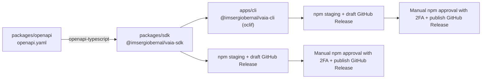

# Contributing to Vaia

This guide covers local development and pull requests. For installing and using
the published CLI or SDK, start with the [README](README.md). Package publication
is covered separately in the [release and hotfix guide](docs/releasing.md).

## Table of contents

- [Development](#development)
  - [Prerequisites](#prerequisites)
  - [Setup](#setup)
  - [Running the CLI](#running-the-cli)
- [Repository layout](#repository-layout)
- [Workspace scripts](#workspace-scripts)
- [Regenerating SDK types](#regenerating-sdk-types)
- [Code conventions](#code-conventions)
- [Commit messages](#commit-messages)
- [Tests and pull requests](#tests-and-pull-requests)
- [Releases and hotfixes](#releases-and-hotfixes)

## Development

### Prerequisites

- **Node.js 22.12+** for workspace development (`@commitlint/cli` requires at least
  22.12.0). The published CLI and SDK target Node.js 22+.
- **pnpm 12.6.0** — install or activate this version before running the workspace
  commands. It is pinned in [package.json](package.json) via `packageManager` and
  `devEngines`.

### Setup

```sh
git clone https://github.com/imsergiobernal/vaia.git
cd vaia
pnpm install --frozen-lockfile
pnpm build
pnpm typecheck
pnpm test
```

Run workspace commands from the repository root. The build compiles the SDK,
then the CLI; the OpenAPI package contains the contract and has no build script.

### Running the CLI

```sh
pnpm --filter @imsergiobernal/vaia-cli dev config set-token
pnpm --filter @imsergiobernal/vaia-cli dev
pnpm --filter @imsergiobernal/vaia-cli dev studysets list
pnpm --filter @imsergiobernal/vaia-cli dev flashcards list 71434395
pnpm --filter @imsergiobernal/vaia-cli dev flashcards list --help
```

`config set-token` prompts for a Vaia API token in an interactive terminal.
For CI/CD, set `VAIA_API_TOKEN` in the environment. Replace the example study set
ID with one returned by `studysets list`.

Running without arguments in an interactive terminal opens the menu; otherwise
it displays help. `dev` runs the CLI once. Rerun it after editing CLI sources and
rebuild the SDK after editing SDK sources, because the CLI imports its compiled
output.

Pass arguments directly after `dev`; an extra `--` is forwarded to the CLI and
causes `command -- not found`. Relative payload paths resolve from `apps/cli`,
where pnpm runs the script. Full command and configuration details are in the
[CLI reference](apps/cli/README.md).

## Repository layout



| Path | Responsibility |
| --- | --- |
| [apps/cli](apps/cli/) | oclif commands under `src/commands/`, the interactive menu under `src/interactive/`, and local configuration. Depends on the SDK via `workspace:*`. |
| [packages/sdk](packages/sdk/) | Typed ESM HTTP client built on `openapi-fetch`, resource methods and generated OpenAPI schema types. |
| [packages/openapi](packages/openapi/) | OpenAPI 3.0 contract in `openapi.yaml`; workspace-only and never published. |
| [scripts](scripts/) | Release preparation, notes validation/synchronization, publication validation and notes extraction, with Node.js tests. |
| [.github/workflows](.github/workflows/) | CI, single-branch release preparation with automatic PR drafts, owner-only manual synchronization fallback and tag-triggered CLI/SDK publication. |
| [.github/actions](.github/actions/) | Verification of packed CLI and SDK packages outside the workspace. |
| [docs/releasing.md](docs/releasing.md) | Release and hotfix procedure, Git Flow Next setup and preparation bot configuration. |

## Workspace scripts

| Script | Description |
| --- | --- |
| `pnpm build` | Compile the SDK, then the CLI. |
| `pnpm dev` | Run the CLI once; it is currently the only package with a `dev` script. |
| `pnpm typecheck` | Type-check the whole workspace without emitting. |
| `pnpm lint` | Currently fails because no package defines a `lint` script; no source linter is configured. |
| `pnpm commitlint --edit <commit-message-file>` | Validate a commit message against the repository's Conventional Commits rules. |
| `pnpm generate` | Regenerate SDK schema types from the OpenAPI contract. |
| `pnpm test` | Run `node --test` over `scripts/*.test.mjs`. |
| `pnpm release:prepare <branch>` | Generate an automatic draft and, if missing, the initial changelog entry; see the [release guide](docs/releasing.md) for branches and required credentials. |

## Regenerating SDK types

The SDK's request/response schema in
`packages/sdk/src/generated/schema.ts` is generated from
[packages/openapi/openapi.yaml](packages/openapi/openapi.yaml). After changing the
contract, regenerate the types and check both consumers:

```sh
pnpm generate
pnpm build
pnpm typecheck
```

`pnpm generate` runs `openapi-typescript` against the contract. Include the
regenerated schema with the contract change; never hand-edit generated files.

## Code conventions

- Use strict TypeScript and ESM. The workspace targets ES2022 with NodeNext module
  resolution; use explicit `.js` extensions in relative imports where required.
- Match the existing code style. No source-code linter or formatter is configured.
- Keep changes scoped to the affected packages. Update the OpenAPI contract and
  regenerate types when API schema changes affect the SDK.

## Commit messages

Use Conventional Commits; generated release notes depend on them. The rules in
[.commitlintrc.json](.commitlintrc.json) extend `@commitlint/config-conventional`
and also allow the `deps` type.

Write short descriptions in English, starting with an imperative verb in
lowercase (`add`, `fix`, `update` or `remove`) and without a final period. This is
the project's writing convention; commitlint does not check language or verb mood.

Scopes are optional. When present, use the lowercase catalog below. Join multiple
scopes with a comma, for example `fix(cli,sdk): handle empty responses`.

| Scope | Responsibility |
| --- | --- |
| `cli` | CLI commands, interactive menu, configuration and CLI documentation. |
| `sdk` | HTTP client, resources and SDK documentation. |
| `openapi` | API contract and type regeneration resulting from its changes. |
| `release` | Version preparation, validation, publication and Gitflow automation. |
| `workspace` | Monorepo structure, pnpm, shared configuration and general CI. |
| `tooling` | Development tools, editor configuration, agent instructions and commitlint. |

Choose scopes by the purpose of the change. Documentation, tests and dependency
changes use their corresponding types (`docs`, `test`, `deps`):

```text
feat(cli): add tag filtering
fix(cli,sdk): handle empty responses
feat(openapi,sdk): support tag filtering
docs: clarify installation
test(release): add tag validation coverage
deps(cli): update SDK dependency
chore(tooling): configure commitlint
```

Validate a message file before committing:

```sh
pnpm commitlint --edit <commit-message-file>
```

You can also pipe a message into `pnpm commitlint`. Validation checks the message
format, not whether scopes match changed files. Apply the convention to new
messages without rewriting existing history.

## Tests and pull requests

Continue new features on `develop`; release and hotfix branches are for
corrections and package preparation. Use a Conventional Commit title for the PR,
such as `feat(cli): add tag filtering`, and keep changes focused.

Before pushing, run:

```sh
pnpm build
pnpm typecheck
pnpm test
```

The test suite uses Node.js's built-in test runner. Tests live in `scripts/` as
`*.test.mjs`; add or update them when changing release tooling. There is no
separate unit, integration or end-to-end suite.

CI also runs CLI smoke checks and verifies packed CLI/SDK tarballs outside the
workspace using the actions under `.github/actions/`. Wait for CI to pass before
merging.

## Releases and hotfixes

CLI and SDK have independent versions. Follow [docs/releasing.md](docs/releasing.md)
for branch naming, component version preparation, Git Flow Next, Release Please
and publication. Each release PR goes directly from its release branch to `main`.
After stabilization, draft notes in your personal Codex session
and follow the [release notes procedure](docs/releasing.md#draft-final-release-notes).
The preparation workflow updates the automatic draft and fresh editorial notes
in the release PR. Only `imsergiobernal` may run the manual synchronization
fallback. Keep the procedures in the release guide.
