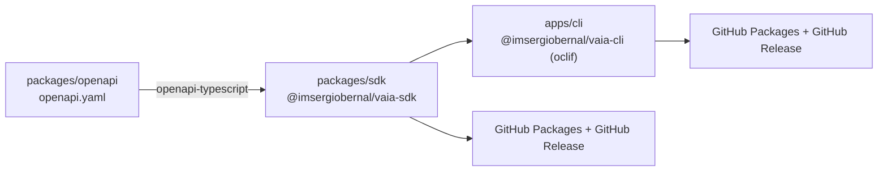

# Vaia

**Open-source toolkit for managing your [Vaia](https://www.vaia.com) content — study sets, flashcards and tags — from the terminal or any Node.js application.**

This monorepo contains three components that share a single source of truth:

- **`@imsergiobernal/vaia-cli`** — an interactive and scriptable CLI for browsing, creating, updating, moving and bulk-managing flashcards, study sets and tags.
- **`@imsergiobernal/vaia-sdk`** — a fully typed ESM HTTP client generated from the OpenAPI contract, published to GitHub Packages.
- **`@vaia/openapi`** — the OpenAPI 3.0 description of the Vaia API that drives SDK type generation.

[](https://github.com/imsergiobernal/vaia/actions/workflows/ci.yml)
[](https://nodejs.org/)
[](https://pnpm.io/)
[](https://www.typescriptlang.org/)
[](#license)

## Table of contents

- [Quick start](#quick-start)
- [Features](#features)
- [Repository layout](#repository-layout)
- [Development](#development)
  - [Prerequisites](#prerequisites)
  - [Setup](#setup)
  - [Workspace scripts](#workspace-scripts)
  - [Regenerating SDK types](#regenerating-sdk-types)
- [Releases and hotfixes](#releases-and-hotfixes)
- [Contributing](#contributing)
- [License](#license)

## Quick start

### CLI (from GitHub Packages)

Configure the registry in your user npm configuration and authenticate with a
GitHub personal access token (classic) with `read:packages` and access to the CLI
and SDK packages:

```sh
npm config set @imsergiobernal:registry https://npm.pkg.github.com --location=user
npm login --scope=@imsergiobernal --registry=https://npm.pkg.github.com --auth-type=legacy
npm install --global @imsergiobernal/vaia-cli
vaia
vaia flashcards list <studyset-id>
```

For local development, run it from this workspace:

```sh
pnpm install --frozen-lockfile
pnpm --filter @imsergiobernal/vaia-cli dev            # interactive menu
pnpm --filter @imsergiobernal/vaia-cli dev -- flashcards list <studyset-id>   # scriptable mode
```

Full command reference, flags and examples live in [`apps/cli/README.md`](apps/cli/README.md).

### SDK (from GitHub Packages)

```sh
npm install @imsergiobernal/vaia-sdk
```

```js
import { createClient } from '@imsergiobernal/vaia-sdk';

const client = createClient({ token: process.env.VAIA_API_TOKEN });
const studysets = await client.studysets.list();
```

Registry configuration and authentication details are in [`packages/sdk/README.md`](packages/sdk/README.md).

### Authentication

Both components authenticate with a Vaia API token. Set `VAIA_API_TOKEN` for CI/CD, or store it locally through the CLI (`config set-token`, entered via hidden prompt). `VAIA_API_URL` overrides the saved/default API URL.

## Features

- **Interactive menu** — browse study sets, drill into subsets and flashcards with zero configuration; running the CLI without arguments opens it.
- **Scriptable commands** — every interactive action has a non-interactive equivalent with structured output for pipelines (`flashcards`, `studysets`, `tags`, `config`).
- **Bulk operations** — validate-first bulk updates with bounded concurrency, automatic retries on rate limits and server errors, `--dry-run` mode, and failed-ID reporting for safe re-runs.
- **Cursor pagination & filtering** — page through results with cursors; filter by search text, ratings, visibility, creator, ordering, quantity and tag IDs.
- **Typed SDK** — request/response types generated from the OpenAPI contract via `openapi-typescript`; no hand-maintained interfaces to drift out of sync.
- **Reproducible releases** — independent CLI/SDK versioning with Git Flow Next, Release Please preparation PRs, and tag-triggered publication verified end-to-end in CI.

## Repository layout



| Path | Package | Description |
| --- | --- | --- |
| [`apps/cli`](apps/cli/) | `@imsergiobernal/vaia-cli` | oclif-based CLI: interactive menu plus scriptable commands for flashcards, study sets and tags. Published to GitHub Packages; exposes the `vaia` executable. |
| [`packages/sdk`](packages/sdk/) | `@imsergiobernal/vaia-sdk` | Typed ESM client for the Vaia API (Node.js 22+). Published to GitHub Packages with independent versioning. |
| [`packages/openapi`](packages/openapi/) | `@vaia/openapi` | OpenAPI contract of the Vaia API; single source of truth for SDK types. Workspace-only, not published. |
| [`scripts/`](scripts/) | — | Release tooling: preparation (`prepare-release.mjs`), validation (`validate-release.mjs`) and release-notes extraction (`release-notes.mjs`), each with tests. |
| [`.github/workflows/`](.github/workflows/) | — | CI, Release Please preparation, and tag-triggered CLI/SDK publication pipelines. |
| [`docs/releasing.md`](docs/releasing.md) | — | The complete release and hotfix procedure, including Git Flow Next setup and the preparation bot configuration. |

## Development

### Prerequisites

- **Node.js 22+** (the supported runtime for both published components)
- **pnpm 12.6.0** — the exact version is pinned in `package.json` (`packageManager`) and enforced via `devEngines`; corepack or a pnpm manager will download it automatically on first run

### Setup

```sh
git clone https://github.com/imsergiobernal/vaia.git && cd vaia
pnpm install --frozen-lockfile
pnpm build        # builds all packages (openapi → sdk → cli)
pnpm typecheck    # strict TypeScript checks across the workspace
pnpm test         # runs the release-tooling test suite
```

### Workspace scripts

| Script | Description |
| --- | --- |
| `pnpm build` | Build every package in dependency order. |
| `pnpm dev` | Run all packages' dev tasks in parallel (CLI watch mode). |
| `pnpm typecheck` | Type-check the whole workspace without emitting. |
| `pnpm lint` | Lint every package that defines a linter. |
| `pnpm generate` | Regenerate SDK types from the OpenAPI contract (see below). |
| `pnpm test` | Run `node --test` over `scripts/*.test.mjs`. |
| `pnpm release:prepare <branch>` | Create/update the Release Please preparation PR for a `release/*` or `hotfix/*` branch. Requires `GITHUB_REPOSITORY` and an installation token in `RELEASE_PLEASE_TOKEN`; see [docs/releasing.md](docs/releasing.md). |

### Regenerating SDK types

The SDK's request/response schema is generated, never hand-edited:

```sh
pnpm generate   # openapi-typescript packages/openapi/openapi.yaml → packages/sdk/src/generated/schema.ts
```

After updating `packages/openapi/openapi.yaml`, regenerate and re-run `pnpm build` + `pnpm typecheck`.

## Releases and hotfixes

CLI and SDK are versioned and published **independently**. The full procedure — branch naming, Git Flow Next configuration, the Release Please preparation bot, stabilization workflow and tag-triggered publication — is documented in [`docs/releasing.md`](docs/releasing.md). In short:

- `release/<component>-vX.Y.Z` / `hotfix/<component>-vX.Y.Z` branches prepare exactly one component.
- Pushes to those branches open or update a **preparation PR** (changelog + manifest); merging it does not publish anything.
- Only tags (`cli-v*`, `sdk-v*`) trigger publication, and only after the tagged commit is verified as an ancestor of `main`.

## Contributing

Contributions are welcome! Before opening a pull request:

1. Read [docs/releasing.md](docs/releasing.md) to understand how versions flow through this repo.
2. Write **Conventional Commits** (`feat`, `fix`, `deps`, breaking-change markers) — the generated changelogs depend on them. Use short English descriptions starting with an imperative verb in lowercase (`add`, `fix`, `update`, or `remove`) and without a final period, e.g., `feat(cli): add tag filtering`.
3. Keep changes scoped: a release branch touches exactly one component's manifest; don't bump the other package "to match".
4. Make sure `pnpm build`, `pnpm typecheck` and `pnpm test` all pass locally before pushing.

The imperative is this project's writing convention; [Conventional Commits](https://www.conventionalcommits.org/en/v1.0.0/#specification) requires a short summary without prescribing a verb mood. Commitlint does not check the language or verb mood.

## License

Released under the [ISC License](https://opensource.org/licenses/ISC). See per-package manifests for details.
